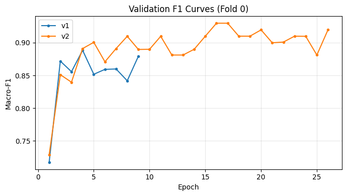
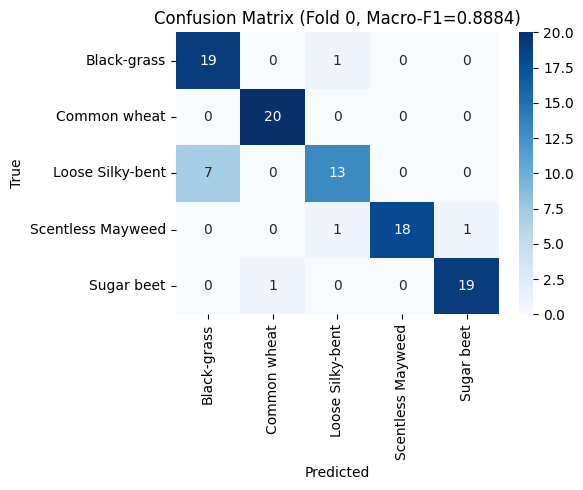
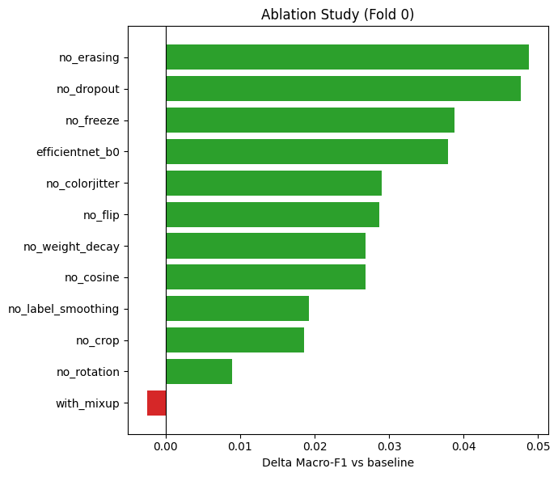

## 第 2 章　小样本植物图像分类

### 2.1 任务与数据

本任务为5类植物幼苗图像的单标签分类，类别为Black-grass、Common wheat、Loose Silky-bent、Scentless Mayweed与Sugar beet，评价指标为Macro-F1。训练集500张，5类各100张，完全均衡；测试集378张，不提供标签。图像统一缩放至224×224，背景多为土壤，光照与拍摄距离差异明显。每类仅100张且禁用外部数据，模型容易依赖背景而非叶片形态；Black-grass与Loose Silky-bent苗期均为细长窄叶，类间边界模糊，因此方法需以迁移学习为主。

### 2.2 方法设计

#### 2.2.1 整体框架

训练图经随机增强送入ImageNet预训练骨干，再由Dropout与线性层输出5类logits；两阶段训练后，集成5折×2骨干共10个模型，推理时再做水平翻转TTA。

#### 2.2.2 模型结构与训练策略

ResNet18参数量11.18M，特征维度512；EfficientNet-B0参数量4.01M，特征维度1280。两者均加载ImageNet权重，分类头改为Dropout(0.5)加Linear(→5)。第一阶段冻结骨干，仅训练分类头8轮，学习率1e-3；第二阶段解冻全部参数，微调30轮，学习率1e-4，采用CosineAnnealing，patience=5。前者避免新初始化的分类头破坏预训练特征，后者使骨干适配植物域。优化器为AdamW，batch size为16，weight_decay为1e-4，LabelSmoothing为0.1。

#### 2.2.3 数据增强

表2-1　训练阶段的数据增强

| 增强方式 | 参数 | 设计动机 |
|---|---|---|
| RandomResizedCrop | scale=(0.7,1.0) | 模拟尺度变化 |
| RandomHorizontalFlip | p=0.5 | 利用左右对称性 |
| RandomRotation | 15° | 覆盖拍摄角度变化 |
| ColorJitter | 亮度、对比度、饱和度均为0.3 | 适应光照差异 |
| RandomErasing | p=0.25 | 模拟局部遮挡 |

#### 2.2.4 集成与TTA

按StratifiedKFold划分5折，seed=42，每折训练两个骨干，共10个模型。推理时对原图与水平翻转图的softmax概率取平均，再对10个模型等权平均后取argmax。概率平均比投票更平滑，可削弱单模型的过置信错误。

### 2.3 实验设置

表2-2　训练与交叉验证设置

| 项目 | 设置 |
|---|---|
| 交叉验证 | StratifiedKFold，5折，seed=42 |
| 每折训练/验证 | 400张/100张 |
| batch size | 16 |
| 优化器 | AdamW，weight_decay=1e-4 |
| 阶段一 | 冻结骨干，8轮，lr=1e-3 |
| 阶段二 | 全参数，30轮，lr=1e-4，CosineAnnealing，patience=5 |
| 集成 | 5折×2骨干=10模型，水平翻转TTA |

消融固定Fold 0与seed=42，共13项配置，每次只关闭或替换一个模块，baseline为0.8719。超参数搜索在第二个实验notebook的Cell9中完成，考察微调学习率、Dropout与LabelSmoothing，其中微调学习率5e-4的0.8899略优于1e-4的0.8884。每折在100张验证样本上计算Macro-F1，报告5折均值、标准差及最好/最差折。测试集无标签，只能报告预测分布，不能计算F1，也不能用于模型选择。

### 2.4 结果

#### 2.4.1 两模型五折对比

表2-3　ResNet18 与 EfficientNet-B0 的五折结果（Macro-F1）

| 模型 | 参数量 | 5折均值 | 标准差 | 最好折 | 最差折 |
|---|---|---|---|---|---|
| ResNet18 | 11.18M | 0.8860 | 0.0321 | 0.9203 | 0.8376 |
| EfficientNet-B0 | 4.01M | 0.9152 | 0.0381 | 0.9599 | 0.8460 |

EfficientNet-B0均值高0.0292，最好折高0.0396；最差折0.8460也略高于0.8376，但极差0.1139大于0.0827，说明其上限更高、波动更大。图2-1中ResNet18较早停滞，EfficientNet-B0上升更久。图2-2为该折混淆矩阵，Macro-F1为0.8884，100张中11张错分，且错误集中于Loose Silky-bent与Black-grass。

#### 2.4.2 集成与TTA

10个模型集成加TTA的预测分布如下表。Black-grass为103张，Sugar beet仅39张，相差64张，明显偏离训练集均衡先验。由于测试标签不可见，该分布只反映预测倾向，不能据此计算F1；若测试类别先验不均衡，验证集Macro-F1可能偏离测试表现。

表2-4　10 模型集成加 TTA 的测试集预测分布

| 类别 | 测试集预测数 |
|---|---|
| Black-grass | 103 |
| Common wheat | 91 |
| Loose Silky-bent | 80 |
| Scentless Mayweed | 65 |
| Sugar beet | 39 |

#### 2.4.3 消融实验

下表按ΔMacro-F1排序。除baseline外，12项配置中11项上升，仅with_mixup下降。提升最大的是no_erasing(+0.0488)、no_dropout(+0.0477)、no_freeze(+0.0388)；efficientnet_b0为0.9098(+0.0379)，与5折方向一致。no_rotation仅+0.0089，旋转增强在该折作用有限；with_mixup为0.8694(−0.0025)。

| 配置 | Macro-F1 | Δ vs baseline |
|---|---|---|
| no_erasing | 0.9207 | +0.0488 |
| no_dropout | 0.9196 | +0.0477 |
| no_freeze | 0.9107 | +0.0388 |
| efficientnet_b0 | 0.9098 | +0.0379 |
| no_colorjitter | 0.9009 | +0.0290 |
| no_flip | 0.9006 | +0.0287 |
| no_weight_decay | 0.8987 | +0.0268 |
| no_cosine | 0.8987 | +0.0268 |
| no_label_smoothing | 0.8911 | +0.0192 |
| no_crop | 0.8905 | +0.0186 |
| no_rotation | 0.8808 | +0.0089 |
| baseline | 0.8719 | 0 |
| with_mixup | 0.8694 | −0.0025 |

### 2.5 分析

#### 2.5.1 EfficientNet-B0更优的原因

EfficientNet-B0在5折均值上领先0.0292，Fold 0消融也高0.0379，方向一致。原因有三：MBConv的深度可分离卷积与SE注意力对细粒度纹理更敏感；4.01M参数仅为ResNet18的36%，在500张样本下容量更可控；复合缩放使深度、宽度与分辨率更平衡。但其标准差0.0381高于0.0321，均值差小于一个标准差，只能称其在本数据划分下平均更好，不能断言显著占优，更适合作为集成成员提供多样性。

#### 2.5.2 移除正则项后分数反而上升

关闭正则项后分数普遍上升：no_erasing为0.9207、no_dropout为0.9196、no_weight_decay为0.8987、no_label_smoothing为0.8911，均高于baseline 0.8719；另一组超参数搜索中，Dropout=0.2的0.8999优于0.5的0.8719，LabelSmoothing=0的0.9092优于0.1的0.8890。这并非“正则化有害”，而是当前强度在500张样本、强增强与早停组合下过大，造成过度约束与欠拟合。

微调仅30轮且patience=5，模型易在充分拟合前停止；Dropout 0.5丢弃一半特征，LabelSmoothing 0.1压平目标，二者叠加使输出保守、类间边界模糊；weight_decay 1e-4限制骨干适配；RandomErasing 0.25又删去局部叶形信息。增强本身已是强正则，再叠加多项正则，偏差上升超过方差下降。消融仅Fold 0且每配置只跑一次，0.02以内差异可能来自划分噪声，结论应限定为“该数据与训练预算下应降低正则强度”。

#### 2.5.3 小样本下的方差问题

两模型5折标准差为0.0321与0.0381，极差为0.0827与0.1139，对划分敏感。每折验证仅100张，单张样本即可明显改变Macro-F1；5折均值仍是有限估计，0.0292的均值差小于标准差，不宜做显著性断言。10个模型集成与TTA在预测层面平均多个输出，有助于降低方差，故最终提交采用集成而非单折最优模型。

#### 2.5.4 Loose Silky-bent类的困难

图2-2中11个错分有7个是Loose Silky-bent误判为Black-grass，占六成以上。该类F1仅0.7429，Black-grass为0.8261，而Common wheat为0.9756、Sugar beet为0.9500、Scentless Mayweed为0.9474。可见最弱类为Loose Silky-bent，而非Common wheat。瓶颈集中在这一对相似类：两者苗期均细长窄叶，裁剪缩放后纹理接近，叶宽与颜色差异被削弱，每类仅100张也难以学到稳定边界。后续应针对该混淆对设计判别性损失或局部特征增强，而非整体加强正则。

### 2.6 局限与改进

局限有四：测试集无标签，只能间接评估；消融仅Fold 0且未重复，无置信区间，超参搜索也仅覆盖三个维度；两阶段轮数与patience固定，未与正则强度联合调优；集成加TTA的推理开销约为单模型20倍。

改进方向：采用5×5重复交叉验证，对关键配置使用3个随机种子重复；用嵌套交叉验证联合选择正则强度与早停轮数；按类报告F1与混淆矩阵，对Loose Silky-bent与Black-grass引入度量学习或二阶段分类器；在参数量受控下尝试更强预训练权重，并用类先验校正缓解分布偏移。
