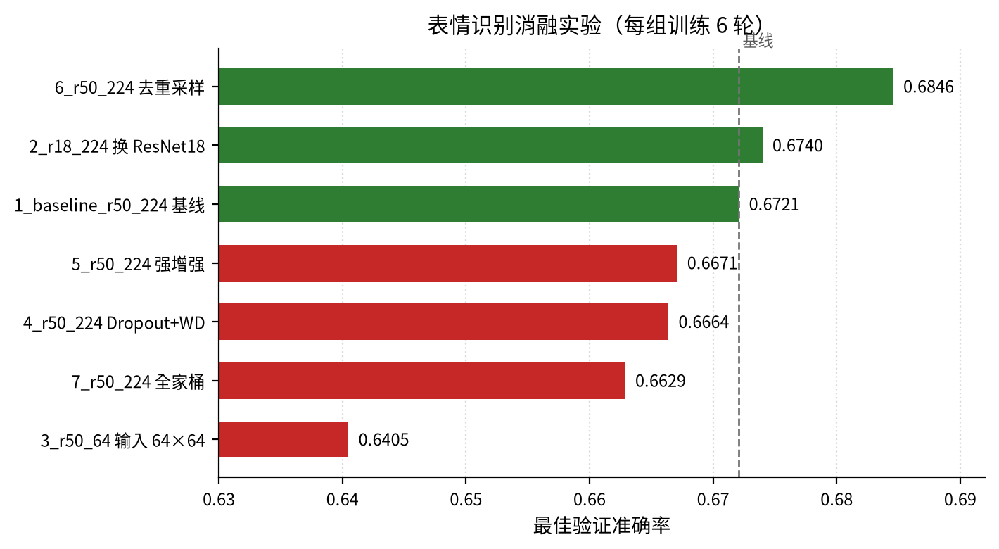

## 第 3 章　人脸表情识别

人脸表情识别是细粒度图像分类任务。本章介绍六类表情识别的数据、迁移学习方案与实验结果，并分析影响验证性能的主要因素。

### 3.1 任务与数据

#### 3.1.1 任务定义

输入一张人脸图像，输出Angry、Fear、Happy、Sad、Surprise、Neutral六类之一，以Accuracy评价。测试集无公开标签，提交须按模板ID排序，故模型选择仅依据验证集。

#### 3.1.2 数据与类别分布

训练集28275张，均为48×48灰度图（L模式）；测试集7065张，与提交模板ID完全对应，缺失0。类别分布见表3-1，Happy最多、Surprise最少，最大/最小为2.25，存在中度不平衡。

表3-1　训练集类别分布

| 类别 | 样本数 |
|---|---:|
| Angry | 3963 |
| Fear | 4097 |
| Happy | 7192 |
| Sad | 4862 |
| Surprise | 3202 |
| Neutral | 4959 |
| 合计 | 28275 |

### 3.2 方法设计

#### 3.2.1 模型与预处理

以ImageNet预训练ResNet18为主干，最后一层全连接改为6类。ResNet18由残差块构成，参数量适中，适合在有限数据上微调。图像由L模式转RGB，缩放至224×224并按ImageNet均值、标准差归一化。训练增强为RandomHorizontalFlip、RandomRotation(10)、ColorJitter(0.2,0.2)；验证和测试仅做确定性缩放与归一化。

#### 3.2.2 划分与训练策略

按85%/15%分层划分，seed=42，训练约24034张、验证约4241张；分层保持各类别比例，降低验证集构成偏斜。损失为CrossEntropyLoss，优化器AdamW，lr=1e-4、weight_decay=1e-4，CosineAnnealingLR的T_max=30。最多训练30轮，batch size=32，shuffle=True且不重采样；以验证准确率监控，patience=5，保存最佳权重并于早停后回滚。

#### 3.2.3 TTA

对原图和水平翻转图各前向一次，对两组logits取平均后argmax；不是对softmax概率取平均。TTA仅用于生成提交。

### 3.3 实验设置

主实验N2使用上述30轮配置。N1作为训练策略参照：训练15轮、使用WeightedRandomSampler、无TTA。对照模型EfficientNet-B0采用相同数据划分与训练框架。消融共7组，每组6轮并固定同一划分，以ResNet50、224×224、基础增强为基线，分别改变主干、输入尺寸、采样或正则；6轮结果只作横向筛选。所有报告值均为验证集最佳Accuracy，测试标签未参与调参。

### 3.4 实验结果

#### 3.4.1 主模型

N2最佳验证准确率0.6834，出现在第20轮，第25轮早停；N1最佳为0.6763。N2较N1高0.71个百分点，但N1仅训练15轮且使用重采样，差异不能视为单变量收益。N2经TTA的提交预测为Angry 759、Fear 820、Happy 1781、Sad 1375、Surprise 803、Neutral 1527，六类均有输出，合计7065条，未发生类别坍缩。

#### 3.4.2 对照模型

EfficientNet-B0最佳验证0.6711，第6轮见顶、第11轮早停，比ResNet18低1.23个百分点，但差距有限，尚不足以判定主干优劣。ResNet18训练约1126s，ResNet50约2278s，前者耗时约为后者一半。

#### 3.4.3 消融实验

表3-2和图3-1给出7组结果。关闭重采样后，最佳验证准确率由0.6721升至0.6846，提升1.25个百分点，为最大正向改动；换ResNet18仅升0.19个百分点；输入降至64×64跌至0.6405，下降约3.2个百分点；强增强、Dropout+weight_decay分别降0.50和0.57个百分点；全家桶降至0.6629，降0.92个百分点。N1的重采样版本0.6763也低于关闭重采样结果，但两者训练轮数不同，只能作为方向性证据。需要强调，消融均只训练6轮，绝对精度不能与30轮主实验直接横比。

表3-2　消融实验结果（每组训练6轮）

| 实验组 | 改动 | 最佳验证准确率 | 相对基线/pp |
|---|---|---:|---:|
| 1_baseline_r50_224 | 基线 | 0.6721 | 0.00 |
| 2_r18_224 | 换ResNet18 | 0.6740 | +0.19 |
| 3_r50_64 | 输入64×64 | 0.6405 | -3.16 |
| 4_r50_224 | 加Dropout、weight_decay | 0.6664 | -0.57 |
| 5_r50_224 | 强增强 | 0.6671 | -0.50 |
| 6_r50_224 | 关闭重采样 | 0.6846 | +1.25 |
| 7_r50_224 | 强增强、Dropout、weight_decay | 0.6629 | -0.92 |

notebook未记录线上提交得分，故不报告测试集准确率；比较均基于验证集。

### 3.5 分析

#### 3.5.1 224×224输入

224不增加信息，但可避免48×48在浅层快速下采样后丢失眉眼、嘴角细节，并与ImageNet预训练尺度匹配。64×64损失约3.2个百分点，说明空间细节是该任务的关键。

#### 3.5.2 重采样

按类别倒数重采样将训练先验拉向均衡，使决策边界偏向少数类，并重复少数类难样本与噪声；在总体Accuracy下会牺牲多数类。本数据不平衡仅2.25，保留自然先验更合适，关闭重采样提升1.25个百分点即为证据。

#### 3.5.3 强增强与组合正则

强增强、Dropout+weight_decay及全家桶分别下降0.50、0.57、0.92个百分点。6轮短训练下优化预算有限，过强扰动会破坏局部表情线索，多个正则叠加又造成欠拟合。至少在该设置下，继续加正则不是有效方向。

#### 3.5.4 验证波动

验证集约4241张，1个百分点约对应42张，数十张样本的归属变化即可造成可见波动。主模型第20轮最佳、第25轮才早停，说明第20轮后连续5轮未再提升，验证性能已进入平台期；在30轮中取最大值会乐观偏置。EfficientNet第6轮见顶、第11轮早停，也说明该模型对训练进程较敏感。故0.6834与0.6711的1.23个百分点差距，在单次划分下不足以证明架构的稳定优势，也会把验证集噪声带入模型选择。

### 3.6 局限与改进

#### 3.6.1 局限

48×48源图像信息量有限，ImageNet权重与表情任务又存在域差异；仅一次85/15划分并按最佳轮次选型，缺少k折或多种子重复；测试得分未记录，且未分析各类别混淆情况。损失函数也只用了CrossEntropyLoss。

#### 3.6.2 改进方向

后续可改用表情专用预训练权重，如AffectNet等表情数据训练的EmotiEffLib/HSEmotion模型；采用k折或多seed并报告均值、标准差；尝试Focal Loss、Label Smoothing或类别加权交叉熵，与不重采样策略结合；也可扩充TTA或集成ResNet18与EfficientNet-B0。上述方向均未在本文中实验。
