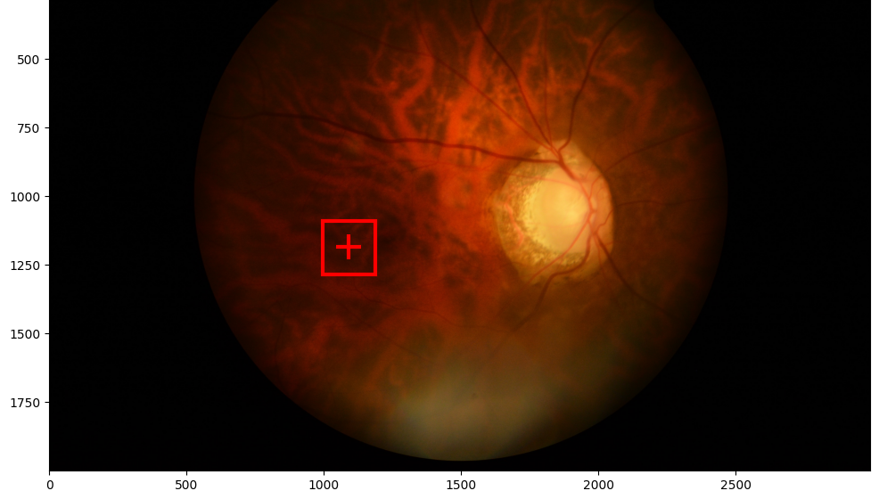

## 第 4 章　眼底黄斑中央凹定位

本章研究眼底图像中黄斑中央凹的自动定位。该任务形式上可视为目标检测，但最终只需输出一个解剖标志点的坐标，并需处理标志点不可见的情况，因此数据、模型与评价均围绕“点定位”组织。

### 4.1 任务与数据

输入为单张彩色眼底图，输出为中央凹坐标(X,Y)；不可见时输出(0,0)。训练集80张（0001–0080），每张均有XML黄斑bbox和CSV中央凹坐标；测试集20张（0081–0100），仅提供图像。评价指标为RMSE，X与Y分两行计算，以分别反映水平和垂直偏差。测试集无真值，notebook也无排行榜反馈，故只能报告交叉验证结果和提交规则，不能报告测试RMSE或排名。

### 4.2 关键观察与问题转化

对训练集的核对显示，XML框中心与CSV真值点存在小偏差：ΔX=0.607±1.318px，ΔY=1.316±1.864px，X/Y方向最大绝对偏差为4.14px和5.0px。若直接把框中心作为坐标，训练集RMSE为1.903px；训练集80张全部可见，无(0,0)负样本。图4-1以0049为例展示标注框与真值点的关系。

这说明bbox中心与中央凹在像素尺度上接近，可将坐标回归转化为目标检测：先定位黄斑，再取预测框中心。需强调，1.903px是标注几何一致性的度量，不是检测模型的泛化误差，只表明“框中心→点”的转换误差量级较小；转化能否奏效，取决于模型能否在未见图像上稳定覆盖黄斑。

### 4.3 方法设计

模型采用Faster R-CNN（ResNet50-FPN v2），加载COCO预训练权重；检测头输出背景与黄斑两类。为降低小数据过拟合，冻结backbone的layer1与layer2，输入缩放至800×800。

增强由albumentations同步变换图像与bbox，包括Rotate±15、BrightnessContrast和ColorJitter。训练采用5折KFold(shuffle=True, random_state=42)，25个epoch，batch size=8；AdamW，lr=1e-4，CosineAnnealingLR；梯度裁剪1.0；按best val_rmse保存权重。推理取预测框中心，检测分数低于tau时输出(0,0)；make_submission实际传入tau=0.15。

### 4.4 实验设置

主实验即上述5折方案，每折16张验证图，得到5个折内最佳验证RMSE。另以FOLDS_SMALL取前3折，batch size=4、10个epoch，设置E1（无增强）、E2（增强）、E3（增强并冻结layer1/layer2）三组对照，评价方式相同。对照实验的预算（batch size=4、10个epoch、3折）明显小于主实验（batch size=8、25个epoch、5折），故只能组内比较，不能与主实验的33.00直接横比。

### 4.5 结果

主实验各折best val_rmse见表4-1。

表4-1　五折交叉验证结果

| 折 | fold0 | fold1 | fold2 | fold3 | fold4 | 五折平均 |
|---|---:|---:|---:|---:|---:|---:|
| best val_rmse/px | 14.10 | 12.45 | 4.50 | 22.15 | 111.81 | 33.00 |

前三折误差在4.50–14.10px之间，fold3为22.15px，fold4升至111.81px；五折平均33.00px。3折对照见表4-2。

表4-2　3折对照实验各折best val_rmse

| 折 | E1 | E2 | E3 |
|---|---:|---:|---:|
| fold0 | 13.78 | 14.70 | 14.01 |
| fold1 | 63.24 | 21.22 | 22.91 |
| fold2 | 5.74 | 4.91 | 5.27 |

E1在fold1达63.24px，E2与E3为21.22px和22.91px；E2三折为14.70、21.22、4.91，OOF为13.61，三组最优。E2的fold1仍高于主实验同折的12.45px，但预算不同，不能据此判断训练策略优劣。

最终提交采用5个模型集成。20张测试图检测置信度为0.800–0.984，最低是0081的0.800，0086为0.850。make_submission实际使用tau=0.15，所有分数均高于阈值，故20张图全部按“可见”输出坐标，没有一张被置为(0,0)。测试集无真值，notebook也无排行榜分数，无法评价这20个坐标的实际RMSE。

### 4.6 分析

fold4的111.81px是主要异常，训练中曾出现636–899px的RMSE尖峰。现有记录只能支持“训练不稳定、回归头崩溃”的描述，不能断言具体机制，也不能说该问题已被梯度裁剪或最佳权重保存修复——最终fold4仍然异常。更稳妥的结论是：当前数据规模与配置下，检测器优化存在明显折间不稳定性，单次训练结果不可靠。

5折平均的33.00px与最佳单折4.50px差距巨大，说明小数据下折间方差主导汇总结果。33.00是5个折内最佳val_rmse的算术平均，并非合并80张验证预测后重算的总体OOF；每折仅16张，等权平均放大fold4影响，也不能给出总体标准误。因此它应理解为各折表现的等权汇总，不宜当作无偏泛化估计，更不能据此推断测试集表现。

交叉验证中分数低于0.5的样本共3张：0070为0.067、误差99.4px，0049为0.315、误差76.8px，0062为0.199、误差31.4px；可计算真值的样本中最大误差为0072的614.5px。训练集分数下限0.713，5%分位0.927，中位数0.980，说明训练集检测分数整体偏高。三张低分样本均伴随较大误差，但样本量太小，不足以证明分数可单独预测误差，更不能据此拟合有统计意义的阈值。

### 4.7 局限与改进

第一，训练集无(0,0)负样本，模型无法学习不可见类别。当前仅靠检测分数加阈值，tau=0.15使20张测试图全部通过，实际等同“全部可见”；交叉验证也无不可见样本，阈值缺乏验证集支撑。若测试集存在不可见图，方法会误输出坐标。应补充不可见图或显式可见性标签，并在独立验证集上选tau。

第二，折间方差过大，最佳单折4.50与五折平均33.00并存；每折仅16张，且best epoch在同一验证集上选择，存在选择偏差。应采用重复交叉验证、嵌套验证或固定外部测试集，并报告均值、标准差和逐折结果。

第三，当前仅利用bbox中心，框回归未被显式约束到中央凹点。可增加中心偏移回归分支，或引入关键点热图与多任务损失，直接优化坐标误差，并对集成做置信度校准。上述改进尚未实施，本文不声称问题已解决；测试集无真值且无排行榜，结论限于交叉验证。
