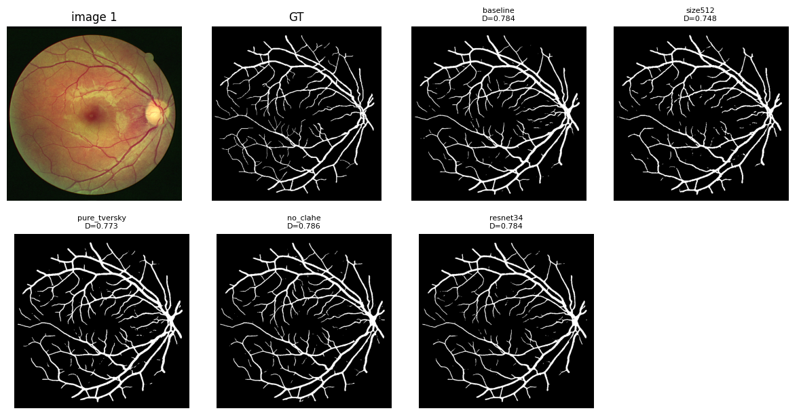

## 第 4 章　眼底血管分割

本章研究眼底图像血管分割。血管细长、末梢仅数像素宽且对比度低，难点在于细小血管的连续性与低对比区域召回。本文以UNet为骨干，结合Tversky损失、五折集成与测试时增强（TTA），并对分辨率、损失、预处理和骨干规模做消融。

### 4.1　任务与数据

训练集20对眼底图像与二值标注，血管取255、背景取0；测试集20张。评价指标为Dice系数，提交文件为RLE编码的CSV。每折验证仅4张，单图误差即可引起明显波动，故同时报告五折均值与各折结果。

### 4.2　方法设计

#### 4.2.1　模型与损失

分割网络采用segmentation_models_pytorch的UNet，编码器ResNet18，加载ImageNet预训练权重，输入3通道RGB，输出单通道概率图。损失函数为0.3×BCE+0.7×Tversky（α=0.3，β=0.8）。Tversky损失的分母中β乘漏检、α乘误检，β>α使漏检受罚更重，符合血管忌断裂的先验；BCE项提供稳定的逐像素梯度。

#### 4.2.2　预处理

图像与标注统一缩放至768×768。第二次实验（记2nd）的主训练数据读取流程没有CLAHE，其主结果是在无CLAHE条件下取得的；第三次实验（记3rd）加入 CLAHE 后，两次五折均值为 0.7863 与 0.7812，与 2nd 的 0.7863 基本持平，no_clahe 消融亦无增益，故最终方案不采用 CLAHE。

#### 4.2.3　五折训练、全量模型与集成

采用5折交叉验证，随机种子设为42，每折16张训练、4张验证；AdamW，lr=5×10⁻⁴，weight_decay=1×10⁻⁴，余弦退火，最多60个epoch，早停耐心为15。另用全部20张训练全量模型100个epoch，T_max=100。预测时将五折均值乘以5/6、全量模型乘以1/6后相加，每个模型做原图、水平翻转、垂直翻转三向TTA后平均。

#### 4.2.4　后处理与导出

概率图以0.6为阈值二值化，删除面积小于50像素的连通域，保存PNG。用官方segmentation_to_csv.py生成RLE，按sample_submission的Id顺序重排。官方脚本会将768×768预测压回512×512再编码，验证与提交存在分辨率口径差。

### 4.3　实验设置

实验分2nd与3rd两次独立运行，均采用随机种子42的5折交叉验证，主结果以五折验证Dice的均值报告。消融固定60个epoch、关闭早停、不回载best、Dice按0.5计算，与主训练协议不同，绝对值不可直接比较。

### 4.4　结果

表4-1为两次运行的五折Dice。2nd 均值 0.7863（0.7888、0.7473、0.8083、0.7954、0.7915）；3rd 重跑均值 0.7812（0.7719、0.7470、0.8048、0.7935、0.7887），提交采用后者。两次均值相差 0.005，但各折之间波动明显（3rd 为 0.7470–0.8048），说明单折分数受数据划分与训练随机性影响很大。

表4-1　两次独立运行的五折验证 Dice

| 折次 | 2nd Dice | 3rd Dice（重跑） |
|---|---|---|
| 第1折 | 0.7888 | 0.7719 |
| 第2折 | 0.7473 | 0.7470 |
| 第3折 | 0.8083 | 0.8048 |
| 第4折 | 0.7954 | 0.7935 |
| 第5折 | 0.7915 | 0.7887 |
| 均值 | 0.7863 | 0.7812 |

图4-1展示测试样本的原图、真值及不同配置的预测，图中标注的Dice为验证集指标，仅用于配置间相对比较。

表4-2为2nd消融结果：baseline为0.7837；size512降至0.7482（−0.036），降分辨率损失最大；pure_tversky降至0.7727（−0.011），BCE不可省；no_clahe为0.7865（+0.003）、resnet34为0.7842（+0.0005），均在噪声内。

表4-2　2nd 消融实验结果（60 轮、不早停、不回载 best、阈值 0.5）

| 配置 | Dice | 相对baseline |
|---|---|---|
| baseline | 0.7837 | — |
| size512 | 0.7482 | −0.036 |
| pure_tversky | 0.7727 | −0.011 |
| no_clahe | 0.7865 | +0.003 |
| resnet34 | 0.7842 | +0.0005 |

导出检查：提交文件按 512×512 口径编码，第 1 行前景 34496 像素（约占 13%）；掩码保存为 PNG，避免有损压缩改变前景像素。提交Id为1–20连续、缺失值为0、shape为(20,2)。线上成绩：私榜 Dice 0.82632，终榜 0.82947。线上高于验证均值（0.7812），可能因为测试集图像质量更均匀、或官方按 512×512 口径计算 RLE，降采样后细血管被裁掉、评分口径与 768 验证不同。

### 4.5　分析

**β>α的召回偏向。**血管像素占比不足一成，正负样本极不平衡。β=0.8对漏检的权重约为α=0.3对误检的2.7倍，模型倾向于提高召回，宁可多判背景为血管，也不愿让血管中断，这对保持血管连续性有利。但pure_tversky降至0.7727，提示纯区域损失在训练早期不够稳定，BCE的逐像素约束不可省。

**集成与TTA。**五折模型在不同划分上训练，平均可降低单折模型对特定4张验证图的方差，对测试集则近似多模型投票；三向翻转TTA把不同朝向的预测拉回同一坐标系平均，降低方向敏感性。本文未报告单折无TTA对照，故只将其作用归为方差缩减，不给数值增益。

**消融协议的可比性。**主训练用早停并回载best、阈值0.6，消融固定60个epoch、不回载best、阈值0.5，因此 2nd 主结果的 0.7863 与消融 baseline 的 0.7837 之间的 0.0026 差值不能归因于单一改动。表4-2的差值仅在消融协议内部有效；每折仅4张验证图，0.003量级差异不足以判定优劣。

**CLAHE无增益。**no_clahe为0.7865，较baseline高0.003，落在噪声内；2nd 主训练本无 CLAHE，均值 0.7863 与 no_clahe 的 0.7865 几乎一致；3rd 加入 CLAHE 后两次运行为 0.7863 与 0.7812，没有稳定提升。20张图下，局部增强可能同时放大背景噪声与血管边缘光晕，其收益被抵消。

**分辨率的影响最大。**512输入使Dice下降0.036，末梢血管在降采样中被抹去；ResNet34仅提高0.0005，说明20张图下增大骨干无明显收益。

### 4.6　踩过的坑

**余弦周期与轮数不一致。**2nd的全量模型设T_max=80，却执行100个epoch，余弦周期短于总轮数，最后20轮不再处于原定退火区间，训练节奏与设定不符；3rd将T_max改为100，使退火覆盖全程。五折模型为60轮，不受影响。

**PNG与JPG。**若存JPG，有损压缩会在血管边缘引入中间灰度，改变前景像素，使原本只有{0,255}的图不再纯净。本文未做JPG对照，此项仅作为潜在风险记录，正式流程统一使用PNG。

### 4.7　局限与改进

局限主要有三：数据仅 20 张，每折验证只有 4 张，Dice 波动范围大；线上（0.826 / 0.829）高于验证（0.781），差约 0.045，现有记录无法归因；消融与主训练协议不一致，集成、TTA、阈值与连通域的影响也缺少同协议下的定量拆解，贡献只能定性；官方RLE按512×512口径编码，而训练预测在768×768，降采样会损失末梢血管，验证与提交存在口径差。

改进方向包括：统一训练与消融协议，补做集成、TTA、阈值与连通域的因子实验；在512×512解码口径上直接评估，或多尺度预测后按官方口径融合；针对细血管引入连通性约束；增加折数或重复实验，报告均值与方差。CLAHE在20张数据上无增益，不应优先投入。
