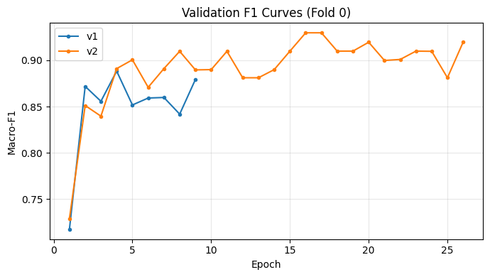
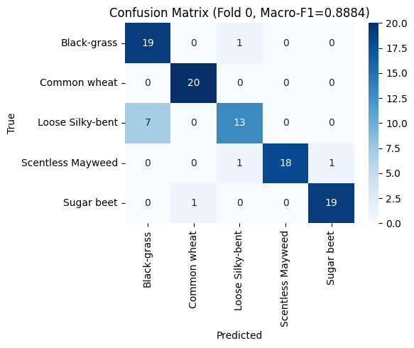
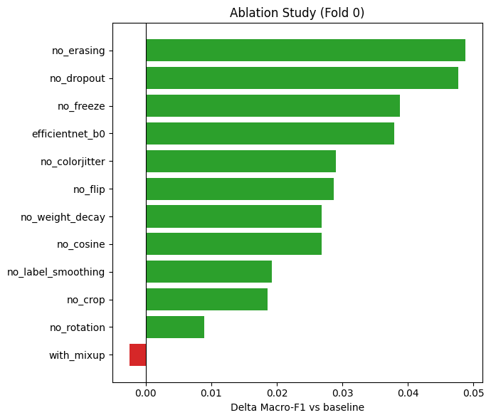

# 机器学习课程设计报告

| 项目 | 内容 |
|---|---|
| 课程 | 机器学习 |
| 题目 | 四项 Kaggle 任务的建模与优化 |
| 姓名 | 高子恒 |
| 学号 | 20245613 |
| 班级 | 人工智能 2402 |
| 日期 | 2026 年 11 月 |

## 摘要

本报告汇总课程设计中的四项任务，均以 Kaggle 竞赛形式给出：小样本植物图像分类、人脸表情识别、眼底黄斑中央凹定位与眼底血管分割。四者分别对应小样本分类、类别不均衡的细粒度分类、目标检测与坐标回归、医学图像二值分割四类典型问题。

四项任务共用一条技术主线：以 ImageNet 预训练骨干为基础做迁移学习，配合与任务匹配的数据增强，按验证集指标保存最佳轮次，最后用多折集成与测试时增强（TTA）压低方差。在此之上，各任务的处理重点不同：植物分类考察小样本下正则化与模型容量的取舍；表情识别考察输入分辨率与类别不均衡的处理；黄斑定位把坐标回归转化为“检测框中心”的检测问题；血管分割的关键在于损失函数对漏检的惩罚、阈值选取与提交格式。

主要结果（均为验证集指标，测试集无公开标签）：

- 植物图像分类：五折 Macro-F1，ResNet18 为 0.8860，EfficientNet-B0 为 0.9152；
- 人脸表情识别：最佳验证准确率 0.6834（第 20 轮）；
- 黄斑中央凹定位：五折验证 RMSE 各折为 14.10、12.45、4.50、22.15、111.81，折间差异极大，三折对照方案最优为 13.61；
- 眼底血管分割：五折验证 Dice 均值 0.7863。

报告中的全部数值均取自 notebook 的实际运行输出，未做修饰。四项任务也留下了若干与直觉相反的结论，例如在小样本加强增强的组合下关闭 dropout 与权重衰减反而提升分数、输入分辨率对表情识别的影响大于更换骨干网络，这些结论连同其证据一并写在对应章节中。

**关键词**：迁移学习；小样本分类；类别不均衡；目标检测；医学图像分割；交叉验证集成

## 第 1 章　任务概述

### 1.1 四项任务一览

| 任务 | 问题类型 | 数据规模 | 评价指标 | 验证结果 |
|---|---|---|---|---|
| 植物图像分类 | 5 类小样本分类 | 训练 500 张 / 测试 378 张 | Macro-F1 | 五折均值 0.9152（EfficientNet-B0） |
| 人脸表情识别 | 6 类细粒度分类 | 训练 28275 张 / 测试 7065 张 | Accuracy | 最佳验证 0.6834 |
| 黄斑中央凹定位 | 检测 + 坐标回归 | 训练 80 张 / 测试 20 张 | RMSE | 五折各折 4.50–111.81 |
| 眼底血管分割 | 二值语义分割 | 训练 20 对 / 测试 20 张 | Dice | 五折均值 0.7863 |

四项任务的测试集均不提供标签，线上成绩通过 Kaggle 排行榜获取，未记录在 notebook 中，因此本报告只报告验证集指标，并对测试集的预测分布或置信度做描述性分析。

### 1.2 共同的技术路线

四项任务的数据规模都不足以从零训练深度网络，因此统一采用迁移学习：

1. **骨干**：以 ImageNet 预训练的 ResNet18 为主，另在对照中尝试 EfficientNet-B0、ResNet34、ResNet50、Faster R-CNN（ResNet50-FPN）与 UNet（ResNet18 编码器）；
2. **输入**：分类任务统一放大到 224×224，分割任务 768×768，检测任务 800×800，均使用 ImageNet 均值方差归一化；
3. **增强**：分类任务用翻转、旋转、颜色扰动与随机擦除，检测与分割任务用图像和标注同步变换；
4. **训练**：AdamW 为主，余弦退火或阶段式学习率，按验证集指标保存最佳轮次，配合早停与梯度裁剪；
5. **推理**：多折模型集成，叠加翻转类 TTA，最后按竞赛模板重排提交文件。

### 1.3 报告组织

第 2 至第 5 章依次对应四项任务，每章结构一致：任务与数据、方法设计、实验设置、结果、分析、局限与改进。第 6 章横向比较四项任务，总结可复用的经验与教训。附录给出复现信息与代码仓库地址。

## 第 2 章　小样本植物图像分类

### 2.1 任务与数据

本任务为5类植物幼苗图像的单标签分类，类别为Black-grass、Common wheat、Loose Silky-bent、Scentless Mayweed与Sugar beet，评价指标为Macro-F1。训练集500张，5类各100张，完全均衡；测试集378张，不提供标签。图像统一缩放至224×224，背景多为土壤，光照与拍摄距离差异明显。每类仅100张且禁用外部数据，模型容易依赖背景而非叶片形态；Black-grass与Loose Silky-bent苗期均为细长窄叶，类间边界模糊，因此方法需以迁移学习为主。

### 2.2 方法设计

#### 2.2.1 整体框架

训练图经随机增强送入ImageNet预训练骨干，再由Dropout与线性层输出5类logits；两阶段训练后，集成5折×2骨干共10个模型，推理时再做水平翻转TTA。

#### 2.2.2 模型结构与训练策略

ResNet18参数量11.18M，特征维度512；EfficientNet-B0参数量4.01M，特征维度1280。两者均加载ImageNet权重，分类头改为Dropout(0.5)加Linear(→5)。第一阶段冻结骨干，仅训练分类头8轮，学习率1e-3；第二阶段解冻全部参数，微调30轮，学习率1e-4，采用CosineAnnealing，patience=5。前者避免新初始化的分类头破坏预训练特征，后者使骨干适配植物域。优化器为AdamW，batch size为16，weight_decay为1e-4，LabelSmoothing为0.1。

#### 2.2.3 数据增强

表2-1　训练阶段的数据增强

| 增强方式 | 参数 | 设计动机 |
|---|---|---|
| RandomResizedCrop | scale=(0.7,1.0) | 模拟尺度变化 |
| RandomHorizontalFlip | p=0.5 | 利用左右对称性 |
| RandomRotation | 15° | 覆盖拍摄角度变化 |
| ColorJitter | 亮度、对比度、饱和度均为0.3 | 适应光照差异 |
| RandomErasing | p=0.25 | 模拟局部遮挡 |

#### 2.2.4 集成与TTA

按StratifiedKFold划分5折，seed=42，每折训练两个骨干，共10个模型。推理时对原图与水平翻转图的softmax概率取平均，再对10个模型等权平均后取argmax。概率平均比投票更平滑，可削弱单模型的过置信错误。

### 2.3 实验设置

表2-2　训练与交叉验证设置

| 项目 | 设置 |
|---|---|
| 交叉验证 | StratifiedKFold，5折，seed=42 |
| 每折训练/验证 | 400张/100张 |
| batch size | 16 |
| 优化器 | AdamW，weight_decay=1e-4 |
| 阶段一 | 冻结骨干，8轮，lr=1e-3 |
| 阶段二 | 全参数，30轮，lr=1e-4，CosineAnnealing，patience=5 |
| 集成 | 5折×2骨干=10模型，水平翻转TTA |

消融固定Fold 0与seed=42，共13项配置，每次只关闭或替换一个模块，baseline为0.8719。超参数搜索在第二个实验notebook的Cell9中完成，考察微调学习率、Dropout与LabelSmoothing，其中微调学习率5e-4的0.8899略优于1e-4的0.8884。每折在100张验证样本上计算Macro-F1，报告5折均值、标准差及最好/最差折。测试集无标签，只能报告预测分布，不能计算F1，也不能用于模型选择。

### 2.4 结果

#### 2.4.1 两模型五折对比

表2-3　ResNet18 与 EfficientNet-B0 的五折结果（Macro-F1）

| 模型 | 参数量 | 5折均值 | 标准差 | 最好折 | 最差折 |
|---|---|---|---|---|---|
| ResNet18 | 11.18M | 0.8860 | 0.0321 | 0.9203 | 0.8376 |
| EfficientNet-B0 | 4.01M | 0.9152 | 0.0381 | 0.9599 | 0.8460 |

EfficientNet-B0均值高0.0292，最好折高0.0396；最差折0.8460也略高于0.8376，但极差0.1139大于0.0827，说明其上限更高、波动更大。图2-1中ResNet18较早停滞，EfficientNet-B0上升更久。图2-2为该折混淆矩阵，Macro-F1为0.8884，100张中11张错分，且错误集中于Loose Silky-bent与Black-grass。

#### 2.4.2 集成与TTA

10个模型集成加TTA的预测分布如下表。Black-grass为103张，Sugar beet仅39张，相差64张，明显偏离训练集均衡先验。由于测试标签不可见，该分布只反映预测倾向，不能据此计算F1；若测试类别先验不均衡，验证集Macro-F1可能偏离测试表现。

表2-4　10 模型集成加 TTA 的测试集预测分布

| 类别 | 测试集预测数 |
|---|---|
| Black-grass | 103 |
| Common wheat | 91 |
| Loose Silky-bent | 80 |
| Scentless Mayweed | 65 |
| Sugar beet | 39 |

#### 2.4.3 消融实验

下表按ΔMacro-F1排序。除baseline外，12项配置中11项上升，仅with_mixup下降。提升最大的是no_erasing(+0.0488)、no_dropout(+0.0477)、no_freeze(+0.0388)；efficientnet_b0为0.9098(+0.0379)，与5折方向一致。no_rotation仅+0.0089，旋转增强在该折作用有限；with_mixup为0.8694(−0.0025)。

| 配置 | Macro-F1 | Δ vs baseline |
|---|---|---|
| no_erasing | 0.9207 | +0.0488 |
| no_dropout | 0.9196 | +0.0477 |
| no_freeze | 0.9107 | +0.0388 |
| efficientnet_b0 | 0.9098 | +0.0379 |
| no_colorjitter | 0.9009 | +0.0290 |
| no_flip | 0.9006 | +0.0287 |
| no_weight_decay | 0.8987 | +0.0268 |
| no_cosine | 0.8987 | +0.0268 |
| no_label_smoothing | 0.8911 | +0.0192 |
| no_crop | 0.8905 | +0.0186 |
| no_rotation | 0.8808 | +0.0089 |
| baseline | 0.8719 | 0 |
| with_mixup | 0.8694 | −0.0025 |

### 2.5 分析

#### 2.5.1 EfficientNet-B0更优的原因

EfficientNet-B0在5折均值上领先0.0292，Fold 0消融也高0.0379，方向一致。原因有三：MBConv的深度可分离卷积与SE注意力对细粒度纹理更敏感；4.01M参数仅为ResNet18的36%，在500张样本下容量更可控；复合缩放使深度、宽度与分辨率更平衡。但其标准差0.0381高于0.0321，均值差小于一个标准差，只能称其在本数据划分下平均更好，不能断言显著占优，更适合作为集成成员提供多样性。

#### 2.5.2 移除正则项后分数反而上升

关闭正则项后分数普遍上升：no_erasing为0.9207、no_dropout为0.9196、no_weight_decay为0.8987、no_label_smoothing为0.8911，均高于baseline 0.8719；另一组超参数搜索中，Dropout=0.2的0.8999优于0.5的0.8719，LabelSmoothing=0的0.9092优于0.1的0.8890。这并非“正则化有害”，而是当前强度在500张样本、强增强与早停组合下过大，造成过度约束与欠拟合。

微调仅30轮且patience=5，模型易在充分拟合前停止；Dropout 0.5丢弃一半特征，LabelSmoothing 0.1压平目标，二者叠加使输出保守、类间边界模糊；weight_decay 1e-4限制骨干适配；RandomErasing 0.25又删去局部叶形信息。增强本身已是强正则，再叠加多项正则，偏差上升超过方差下降。消融仅Fold 0且每配置只跑一次，0.02以内差异可能来自划分噪声，结论应限定为“该数据与训练预算下应降低正则强度”。

#### 2.5.3 小样本下的方差问题

两模型5折标准差为0.0321与0.0381，极差为0.0827与0.1139，对划分敏感。每折验证仅100张，单张样本即可明显改变Macro-F1；5折均值仍是有限估计，0.0292的均值差小于标准差，不宜做显著性断言。10个模型集成与TTA在预测层面平均多个输出，有助于降低方差，故最终提交采用集成而非单折最优模型。

#### 2.5.4 Loose Silky-bent类的困难

图2-2中11个错分有7个是Loose Silky-bent误判为Black-grass，占六成以上。该类F1仅0.7429，Black-grass为0.8261，而Common wheat为0.9756、Sugar beet为0.9500、Scentless Mayweed为0.9474。可见最弱类为Loose Silky-bent，而非Common wheat。瓶颈集中在这一对相似类：两者苗期均细长窄叶，裁剪缩放后纹理接近，叶宽与颜色差异被削弱，每类仅100张也难以学到稳定边界。后续应针对该混淆对设计判别性损失或局部特征增强，而非整体加强正则。

### 2.6 局限与改进

局限有四：测试集无标签，只能间接评估；消融仅Fold 0且未重复，无置信区间，超参搜索也仅覆盖三个维度；两阶段轮数与patience固定，未与正则强度联合调优；集成加TTA的推理开销约为单模型20倍。

改进方向：采用5×5重复交叉验证，对关键配置使用3个随机种子重复；用嵌套交叉验证联合选择正则强度与早停轮数；按类报告F1与混淆矩阵，对Loose Silky-bent与Black-grass引入度量学习或二阶段分类器；在参数量受控下尝试更强预训练权重，并用类先验校正缓解分布偏移。

## 第 3 章　人脸表情识别

人脸表情识别是细粒度图像分类任务。本章介绍六类表情识别的数据、迁移学习方案与实验结果，并分析影响验证性能的主要因素。

### 3.1 任务与数据

#### 3.1.1 任务定义

输入一张人脸图像，输出Angry、Fear、Happy、Sad、Surprise、Neutral六类之一，以Accuracy评价。测试集无公开标签，提交须按模板ID排序，故模型选择仅依据验证集。

#### 3.1.2 数据与类别分布

训练集28275张，均为48×48灰度图（L模式）；测试集7065张，与提交模板ID完全对应，缺失0。类别分布见表3-1，Happy最多、Surprise最少，最大/最小为2.25，存在中度不平衡。

表3-1　训练集类别分布

| 类别 | 样本数 |
|---|---:|
| Angry | 3963 |
| Fear | 4097 |
| Happy | 7192 |
| Sad | 4862 |
| Surprise | 3202 |
| Neutral | 4959 |
| 合计 | 28275 |

### 3.2 方法设计

#### 3.2.1 模型与预处理

以ImageNet预训练ResNet18为主干，最后一层全连接改为6类。ResNet18由残差块构成，参数量适中，适合在有限数据上微调。图像由L模式转RGB，缩放至224×224并按ImageNet均值、标准差归一化。训练增强为RandomHorizontalFlip、RandomRotation(10)、ColorJitter(0.2,0.2)；验证和测试仅做确定性缩放与归一化。

#### 3.2.2 划分与训练策略

按85%/15%分层划分，seed=42，训练约24034张、验证约4241张；分层保持各类别比例，降低验证集构成偏斜。损失为CrossEntropyLoss，优化器AdamW，lr=1e-4、weight_decay=1e-4，CosineAnnealingLR的T_max=30。最多训练30轮，batch size=32，shuffle=True且不重采样；以验证准确率监控，patience=5，保存最佳权重并于早停后回滚。

#### 3.2.3 TTA

对原图和水平翻转图各前向一次，对两组logits取平均后argmax；不是对softmax概率取平均。TTA仅用于生成提交。

### 3.3 实验设置

主实验N2使用上述30轮配置。N1作为训练策略参照：训练15轮、使用WeightedRandomSampler、无TTA。对照模型EfficientNet-B0采用相同数据划分与训练框架。消融共7组，每组6轮并固定同一划分，以ResNet50、224×224、基础增强为基线，分别改变主干、输入尺寸、采样或正则；6轮结果只作横向筛选。所有报告值均为验证集最佳Accuracy，测试标签未参与调参。

### 3.4 实验结果

#### 3.4.1 主模型

N2最佳验证准确率0.6834，出现在第20轮，第25轮早停；N1最佳为0.6763。N2较N1高0.71个百分点，但N1仅训练15轮且使用重采样，差异不能视为单变量收益。N2经TTA的提交预测为Angry 759、Fear 820、Happy 1781、Sad 1375、Surprise 803、Neutral 1527，六类均有输出，合计7065条，未发生类别坍缩。

#### 3.4.2 对照模型

EfficientNet-B0最佳验证0.6711，第6轮见顶、第11轮早停，比ResNet18低1.23个百分点，但差距有限，尚不足以判定主干优劣。ResNet18训练约1126s，ResNet50约2278s，前者耗时约为后者一半。

#### 3.4.3 消融实验

表3-2和图3-1给出7组结果。关闭重采样后，最佳验证准确率由0.6721升至0.6846，提升1.25个百分点，为最大正向改动；换ResNet18仅升0.19个百分点；输入降至64×64跌至0.6405，下降约3.2个百分点；强增强、Dropout+weight_decay分别降0.50和0.57个百分点；全家桶降至0.6629，降0.92个百分点。N1的重采样版本0.6763也低于关闭重采样结果，但两者训练轮数不同，只能作为方向性证据。需要强调，消融均只训练6轮，绝对精度不能与30轮主实验直接横比。

表3-2　消融实验结果（每组训练6轮）

| 实验组 | 改动 | 最佳验证准确率 | 相对基线/pp |
|---|---|---:|---:|
| 1_baseline_r50_224 | 基线 | 0.6721 | 0.00 |
| 2_r18_224 | 换ResNet18 | 0.6740 | +0.19 |
| 3_r50_64 | 输入64×64 | 0.6405 | -3.16 |
| 4_r50_224 | 加Dropout、weight_decay | 0.6664 | -0.57 |
| 5_r50_224 | 强增强 | 0.6671 | -0.50 |
| 6_r50_224 | 关闭重采样 | 0.6846 | +1.25 |
| 7_r50_224 | 强增强、Dropout、weight_decay | 0.6629 | -0.92 |

notebook未记录线上提交得分，故不报告测试集准确率；比较均基于验证集。

### 3.5 分析

#### 3.5.1 224×224输入

224不增加信息，但可避免48×48在浅层快速下采样后丢失眉眼、嘴角细节，并与ImageNet预训练尺度匹配。64×64损失约3.2个百分点，说明空间细节是该任务的关键。

#### 3.5.2 重采样

按类别倒数重采样将训练先验拉向均衡，使决策边界偏向少数类，并重复少数类难样本与噪声；在总体Accuracy下会牺牲多数类。本数据不平衡仅2.25，保留自然先验更合适，关闭重采样提升1.25个百分点即为证据。

#### 3.5.3 强增强与组合正则

强增强、Dropout+weight_decay及全家桶分别下降0.50、0.57、0.92个百分点。6轮短训练下优化预算有限，过强扰动会破坏局部表情线索，多个正则叠加又造成欠拟合。至少在该设置下，继续加正则不是有效方向。

#### 3.5.4 验证波动

验证集约4241张，1个百分点约对应42张，数十张样本的归属变化即可造成可见波动。主模型第20轮最佳、第25轮才早停，说明第20轮后连续5轮未再提升，验证性能已进入平台期；在30轮中取最大值会乐观偏置。EfficientNet第6轮见顶、第11轮早停，也说明该模型对训练进程较敏感。故0.6834与0.6711的1.23个百分点差距，在单次划分下不足以证明架构的稳定优势，也会把验证集噪声带入模型选择。

### 3.6 局限与改进

#### 3.6.1 局限

48×48源图像信息量有限，ImageNet权重与表情任务又存在域差异；仅一次85/15划分并按最佳轮次选型，缺少k折或多种子重复；测试得分未记录，且未分析各类别混淆情况。损失函数也只用了CrossEntropyLoss。

#### 3.6.2 改进方向

后续可改用表情专用预训练权重，如AffectNet等表情数据训练的EmotiEffLib/HSEmotion模型；采用k折或多seed并报告均值、标准差；尝试Focal Loss、Label Smoothing或类别加权交叉熵，与不重采样策略结合；也可扩充TTA或集成ResNet18与EfficientNet-B0。上述方向均未在本文中实验。

## 第 4 章　眼底黄斑中央凹定位

本章研究眼底图像中黄斑中央凹的自动定位。该任务形式上可视为目标检测，但最终只需输出一个解剖标志点的坐标，并需处理标志点不可见的情况，因此数据、模型与评价均围绕“点定位”组织。

### 4.1 任务与数据

输入为单张彩色眼底图，输出为中央凹坐标(X,Y)；不可见时输出(0,0)。训练集80张（0001–0080），每张均有XML黄斑bbox和CSV中央凹坐标；测试集20张（0081–0100），仅提供图像。评价指标为RMSE，X与Y分两行计算，以分别反映水平和垂直偏差。测试集无真值，notebook也无排行榜反馈，故只能报告交叉验证结果和提交规则，不能报告测试RMSE或排名。

### 4.2 关键观察与问题转化

对训练集的核对显示，XML框中心与CSV真值点存在小偏差：ΔX=0.607±1.318px，ΔY=1.316±1.864px，X/Y方向最大绝对偏差为4.14px和5.0px。若直接把框中心作为坐标，训练集RMSE为1.903px；训练集80张全部可见，无(0,0)负样本。图4-1以0049为例展示标注框与真值点的关系。

这说明bbox中心与中央凹在像素尺度上接近，可将坐标回归转化为目标检测：先定位黄斑，再取预测框中心。需强调，1.903px是标注几何一致性的度量，不是检测模型的泛化误差，只表明“框中心→点”的转换误差量级较小；转化能否奏效，取决于模型能否在未见图像上稳定覆盖黄斑。

### 4.3 方法设计

模型采用Faster R-CNN（ResNet50-FPN v2），加载COCO预训练权重；检测头输出背景与黄斑两类。为降低小数据过拟合，冻结backbone的layer1与layer2，输入缩放至800×800。

增强由albumentations同步变换图像与bbox，包括Rotate±15、BrightnessContrast和ColorJitter。训练采用5折KFold(shuffle=True, random_state=42)，25个epoch，batch size=8；AdamW，lr=1e-4，CosineAnnealingLR；梯度裁剪1.0；按best val_rmse保存权重。推理取预测框中心，检测分数低于tau时输出(0,0)；make_submission实际传入tau=0.15。

### 4.4 实验设置

主实验即上述5折方案，每折16张验证图，得到5个折内最佳验证RMSE。另以FOLDS_SMALL取前3折，batch size=4、10个epoch，设置E1（无增强）、E2（增强）、E3（增强并冻结layer1/layer2）三组对照，评价方式相同。对照实验的预算（batch size=4、10个epoch、3折）明显小于主实验（batch size=8、25个epoch、5折），故只能组内比较，不能与主实验的33.00直接横比。

### 4.5 结果

主实验各折best val_rmse见表4-1。

表4-1　五折交叉验证结果

| 折 | fold0 | fold1 | fold2 | fold3 | fold4 | 五折平均 |
|---|---:|---:|---:|---:|---:|---:|
| best val_rmse/px | 14.10 | 12.45 | 4.50 | 22.15 | 111.81 | 33.00 |

前三折误差在4.50–14.10px之间，fold3为22.15px，fold4升至111.81px；五折平均33.00px。3折对照见表4-2。

表4-2　3折对照实验各折best val_rmse

| 折 | E1 | E2 | E3 |
|---|---:|---:|---:|
| fold0 | 13.78 | 14.70 | 14.01 |
| fold1 | 63.24 | 21.22 | 22.91 |
| fold2 | 5.74 | 4.91 | 5.27 |

E1在fold1达63.24px，E2与E3为21.22px和22.91px；E2三折为14.70、21.22、4.91，OOF为13.61，三组最优。E2的fold1仍高于主实验同折的12.45px，但预算不同，不能据此判断训练策略优劣。

最终提交采用5个模型集成。20张测试图检测置信度为0.800–0.984，最低是0081的0.800，0086为0.850。make_submission实际使用tau=0.15，所有分数均高于阈值，故20张图全部按“可见”输出坐标，没有一张被置为(0,0)。测试集无真值，notebook也无排行榜分数，无法评价这20个坐标的实际RMSE。

### 4.6 分析

fold4的111.81px是主要异常，训练中曾出现636–899px的RMSE尖峰。现有记录只能支持“训练不稳定、回归头崩溃”的描述，不能断言具体机制，也不能说该问题已被梯度裁剪或最佳权重保存修复——最终fold4仍然异常。更稳妥的结论是：当前数据规模与配置下，检测器优化存在明显折间不稳定性，单次训练结果不可靠。

5折平均的33.00px与最佳单折4.50px差距巨大，说明小数据下折间方差主导汇总结果。33.00是5个折内最佳val_rmse的算术平均，并非合并80张验证预测后重算的总体OOF；每折仅16张，等权平均放大fold4影响，也不能给出总体标准误。因此它应理解为各折表现的等权汇总，不宜当作无偏泛化估计，更不能据此推断测试集表现。

交叉验证中分数低于0.5的样本共3张：0070为0.067、误差99.4px，0049为0.315、误差76.8px，0062为0.199、误差31.4px；可计算真值的样本中最大误差为0072的614.5px。训练集分数下限0.713，5%分位0.927，中位数0.980，说明训练集检测分数整体偏高。三张低分样本均伴随较大误差，但样本量太小，不足以证明分数可单独预测误差，更不能据此拟合有统计意义的阈值。

### 4.7 局限与改进

第一，训练集无(0,0)负样本，模型无法学习不可见类别。当前仅靠检测分数加阈值，tau=0.15使20张测试图全部通过，实际等同“全部可见”；交叉验证也无不可见样本，阈值缺乏验证集支撑。若测试集存在不可见图，方法会误输出坐标。应补充不可见图或显式可见性标签，并在独立验证集上选tau。

第二，折间方差过大，最佳单折4.50与五折平均33.00并存；每折仅16张，且best epoch在同一验证集上选择，存在选择偏差。应采用重复交叉验证、嵌套验证或固定外部测试集，并报告均值、标准差和逐折结果。

第三，当前仅利用bbox中心，框回归未被显式约束到中央凹点。可增加中心偏移回归分支，或引入关键点热图与多任务损失，直接优化坐标误差，并对集成做置信度校准。上述改进尚未实施，本文不声称问题已解决；测试集无真值且无排行榜，结论限于交叉验证。

## 第 5 章　眼底血管分割

本章研究眼底图像血管分割。血管细长、末梢仅数像素宽且对比度低，难点在于细小血管的连续性与低对比区域召回。本文以UNet为骨干，结合Tversky损失、五折集成与测试时增强（TTA），并对分辨率、损失、预处理和骨干规模做消融。

### 5.1　任务与数据

训练集20对眼底图像与二值标注，血管取255、背景取0；测试集20张。评价指标为Dice系数，提交文件为RLE编码的CSV。每折验证仅4张，单图误差即可引起明显波动，故同时报告五折均值与各折结果。

### 5.2　方法设计

#### 5.2.1　模型与损失

分割网络采用segmentation_models_pytorch的UNet，编码器ResNet18，加载ImageNet预训练权重，输入3通道RGB，输出单通道概率图。损失函数为0.3×BCE+0.7×Tversky（α=0.3，β=0.8）。Tversky损失的分母中β乘漏检、α乘误检，β>α使漏检受罚更重，符合血管忌断裂的先验；BCE项提供稳定的逐像素梯度。

#### 5.2.2　预处理

图像与标注统一缩放至768×768。第二次实验（记2nd）的主训练数据读取流程没有CLAHE，其主结果是在无CLAHE条件下取得的；第三次实验（记3rd）虽加入CLAHE，五折均值仍为0.7863，且no_clahe消融亦无增益，故最终方案不采用CLAHE。

#### 5.2.3　五折训练、全量模型与集成

采用5折交叉验证，随机种子设为42，每折16张训练、4张验证；AdamW，lr=5×10⁻⁴，weight_decay=1×10⁻⁴，余弦退火，最多60个epoch，早停耐心为15。另用全部20张训练全量模型100个epoch，T_max=100。预测时将五折均值乘以5/6、全量模型乘以1/6后相加，每个模型做原图、水平翻转、垂直翻转三向TTA后平均。

#### 5.2.4　后处理与导出

概率图以0.6为阈值二值化，删除面积小于50像素的连通域，保存PNG。用官方segmentation_to_csv.py生成RLE，按sample_submission的Id顺序重排。官方脚本会将768×768预测压回512×512再编码，验证与提交存在分辨率口径差。

### 5.3　实验设置

实验分2nd与3rd两次独立运行，均采用随机种子42的5折交叉验证，主结果以五折验证Dice的均值报告。消融固定60个epoch、关闭早停、不回载best、Dice按0.5计算，与主训练协议不同，绝对值不可直接比较。

### 5.4　结果

表5-1为两次运行的五折Dice。2nd均值0.7863（0.7888、0.7473、0.8083、0.7954、0.7915），3rd均值同为0.7863（0.7693、0.7613、0.8081、0.8009、0.7917）。均值一致但各折之间波动明显，说明单折分数受数据划分与训练随机性影响明显。

表5-1　两次独立运行的五折验证 Dice

| 折次 | 2nd Dice | 3rd Dice |
|---|---|---|
| 第1折 | 0.7888 | 0.7693 |
| 第2折 | 0.7473 | 0.7613 |
| 第3折 | 0.8083 | 0.8081 |
| 第4折 | 0.7954 | 0.8009 |
| 第5折 | 0.7915 | 0.7917 |
| 均值 | 0.7863 | 0.7863 |

图5-1展示测试样本的原图、真值及不同配置的预测，图中标注的Dice为验证集指标，仅用于配置间相对比较。

表5-2为2nd消融结果：baseline为0.7837；size512降至0.7482（−0.036），降分辨率损失最大；pure_tversky降至0.7727（−0.011），BCE不可省；no_clahe为0.7865（+0.003）、resnet34为0.7842（+0.0005），均在噪声内。

表5-2　2nd 消融实验结果（60 轮、不早停、不回载 best、阈值 0.5）

| 配置 | Dice | 相对baseline |
|---|---|---|
| baseline | 0.7837 | — |
| size512 | 0.7482 | −0.036 |
| pure_tversky | 0.7727 | −0.011 |
| no_clahe | 0.7865 | +0.003 |
| resnet34 | 0.7842 | +0.0005 |

导出检查：二值PNG的unique为{0,255}；768下前景53068像素（约9.0%），512解码口径为33251–33633（约12.7%）。提交Id为1–20连续、缺失值为0、shape为(20,2)。notebook中没有排行榜或提交得分记录，旧报告中的线上分数无法核实；本章不报告线上成绩，最终线上成绩未记录在notebook中。

### 5.5　分析

**β>α的召回偏向。**血管像素占比不足一成，正负样本极不平衡。β=0.8对漏检的权重约为α=0.3对误检的2.7倍，模型倾向于提高召回，宁可多判背景为血管，也不愿让血管中断，这对保持血管连续性有利。但pure_tversky降至0.7727，提示纯区域损失在训练早期不够稳定，BCE的逐像素约束不可省。

**集成与TTA。**五折模型在不同划分上训练，平均可降低单折模型对特定4张验证图的方差，对测试集则近似多模型投票；三向翻转TTA把不同朝向的预测拉回同一坐标系平均，降低方向敏感性。本文未报告单折无TTA对照，故只将其作用归为方差缩减，不给数值增益。

**消融协议的可比性。**主训练用早停并回载best、阈值0.6，消融固定60个epoch、不回载best、阈值0.5，因此0.7863与0.7837之间0.0026的差值不能归因于单一改动。表5-2的差值仅在消融协议内部有效；每折仅4张验证图，0.003量级差异不足以判定优劣。

**CLAHE无增益。**no_clahe为0.7865，较baseline高0.003，落在噪声内；2nd主训练本无CLAHE，均值0.7863与0.7865几乎一致，3rd加入后仍为0.7863。20张图下，局部增强可能同时放大背景噪声与血管边缘光晕，其收益被抵消。

**分辨率的影响最大。**512输入使Dice下降0.036，末梢血管在降采样中被抹去；ResNet34仅提高0.0005，说明20张图下增大骨干无明显收益。

### 5.6　踩过的坑

**余弦周期与轮数不一致。**2nd的全量模型设T_max=80，却执行100个epoch，余弦周期短于总轮数，最后20轮不再处于原定退火区间，训练节奏与设定不符；3rd将T_max改为100，使退火覆盖全程。五折模型为60轮，不受影响。

**PNG与JPG。**若存JPG，有损压缩会在血管边缘引入中间灰度，改变前景像素，使原本只有{0,255}的图不再纯净。本文未做JPG对照，此项仅作为潜在风险记录，正式流程统一使用PNG。

### 5.7　局限与改进

局限主要有三：数据仅20张，每折验证4张，Dice波动范围大，且缺少线上成绩校验，泛化性难以外部验证；消融与主训练协议不一致，集成、TTA、阈值与连通域的影响也缺少同协议下的定量拆解，贡献只能定性；官方RLE按512×512口径编码，而训练预测在768×768，降采样会损失末梢血管，验证与提交存在口径差。

改进方向包括：统一训练与消融协议，补做集成、TTA、阈值与连通域的因子实验；在512×512解码口径上直接评估，或多尺度预测后按官方口径融合；针对细血管引入连通性约束；增加折数或重复实验，报告均值与方差。CLAHE在20张数据上无增益，不应优先投入。

## 第 6 章　总结

### 6.1 四项任务的横向比较

| 维度 | 植物分类 | 表情识别 | 黄斑定位 | 血管分割 |
|---|---|---|---|---|
| 数据瓶颈 | 样本极少（500 张） | 分辨率低（48×48） | 样本极少（80 张） | 标注极少（20 对） |
| 最关键的一步 | 模型容量与正则的取舍 | 输入分辨率 | 问题转化（框中心） | 损失函数与阈值 |
| 提升最大的做法 | 换 EfficientNet-B0（+0.029） | 224 输入、去重采样（+1.25pp） | bbox 中心代替直接回归（1.90 px） | Tversky 加重漏检惩罚 |
| 最大教训 | 强正则反而压住模型 | 重采样在 Accuracy 下有害 | 折间方差可达 25 倍 | 验证协议不同不能横比 |

### 6.2 可复用的经验

1. **先修数据管线，再调模型。** 四项任务里，收益最大的改动往往不在网络结构上：黄斑定位把回归问题改写成“检测框取中心”，训练集 RMSE 降到 1.90 px；血管分割的提交必须用 PNG 保存二值 mask、再用官方脚本转 RLE 并重排 Id，否则格式问题会直接吞掉全部精度。
2. **验证协议的差异比结果差异更大。** 血管分割的消融实验固定 60 轮、不早停、不回载最佳权重、Dice 按 0.5 计算，而主训练按 best-val 保存、阈值取 0.6，两者不能直接横比。同样，黄斑定位的三折对照用 bs=4、10 轮，主实验用 bs=8、25 轮。写报告时必须把协议差异交代清楚，否则数字会误导。
3. **小数据下方差是第一位的。** 黄斑定位五折为 4.50、12.45、14.10、22.15、111.81，单折最好与最差相差二十余倍；植物分类五折标准差 0.032；表情识别验证集在不同轮次间来回摆动 1–2 个百分点。单次划分的结论不可靠，这也是四项任务都采用 k 折或多种子平均的原因。
4. **正则化不是越多越好。** 植物分类的消融显示，关闭 dropout、权重衰减、随机擦除与标签平滑后分数反而上升，说明在 500 张样本 + 强增强 + 早停的组合下，这些正则项叠加起来过度约束了模型。
5. **记录每一次运行。** 本报告写作过程中最大的时间成本不是跑实验，而是核对数字：同一任务存在多个 notebook 版本，早期版本与最终版本的结果不同，若不记录配置与输出，很容易把不同实验的数字混在一起。

### 6.3 不足

- 四项任务均只做了单机单卡训练，未尝试半监督、伪标签或更大规模的外部数据；
- 表情识别未使用表情专用预训练权重，也未做模型集成；
- 黄斑定位的训练集没有负样本，“不可见”只能靠置信度阈值判断，缺少可验证的准则；
- 血管分割的阈值 0.6 只在验证集上调过，未在测试分布上复核；
- 测试集无标签，本报告无法给出可信的泛化误差，只能以验证集指标与预测分布作为参考。

### 6.4 体会

四项任务做完，最直接的收获不是某个模型或某个技巧，而是判断顺序：拿到一个问题，先看数据规模和标注质量，再看评价指标与验证协议，最后才决定改模型、改数据管线还是改问题的表述方式。多数时候，后两者比换网络有效。另一件事是诚实：把跑出来的数字原样写下来，哪怕它不如预期，也比一个漂亮但对不上的数字有用——后者在复查时一站就穿。

## 附录　复现信息

- 框架：PyTorch + torchvision；分割任务另用 `segmentation_models_pytorch`，检测任务用 torchvision 的 Faster R-CNN；增强用 albumentations
- 环境：Kaggle Notebook，GPU 为 NVIDIA Tesla T4
- 随机种子：数据划分与模型初始化在可设置的环节固定为 42
- 代码仓库：<https://github.com/KathrynCG/ML-CourseDesign>（含四个任务的 notebook 与各任务原始记录）
- 竞赛主页：<https://www.kaggle.com/neucx11/competitions>
- 数据：由课程在 Kaggle 竞赛页提供，未使用外部数据
